# Image Prompt Engineer

A Claude skill that writes detailed image prompts for you. Describe the image in a sentence; get
back a prompt for **Nano Banana** (Google Gemini Image) or **GPT Image** (OpenAI / ChatGPT) that
spells out everything the model needs to get it right.

Writing a good image prompt by hand takes time: subject, framing, light, lens, materials, exact
text, who stands where. This skill does that work. It runs a short creative interview (or skips it
if you say "just go"), fills in every detail, and writes the prompt the way each model reads best.
You copy it and paste it into the Gemini app or ChatGPT. No API key or setup needed.

If you do have an API key, there's an optional script that lets Claude Code generate the image,
review it against the spec and refine it. You don't need it to use the skill.

## Made with it

These are just a few simple examples to give a feel for the range. The skill handles far more
complex briefs than these: several people with set positions, exact text in more than one
language, edits that change one thing and keep the rest, and matched sets of images. All were made
with Nano Banana in the Gemini app, from prompts written by this skill or its earlier version.

### Illustration, design and text

<table>
  <tr>
    <td width="50%">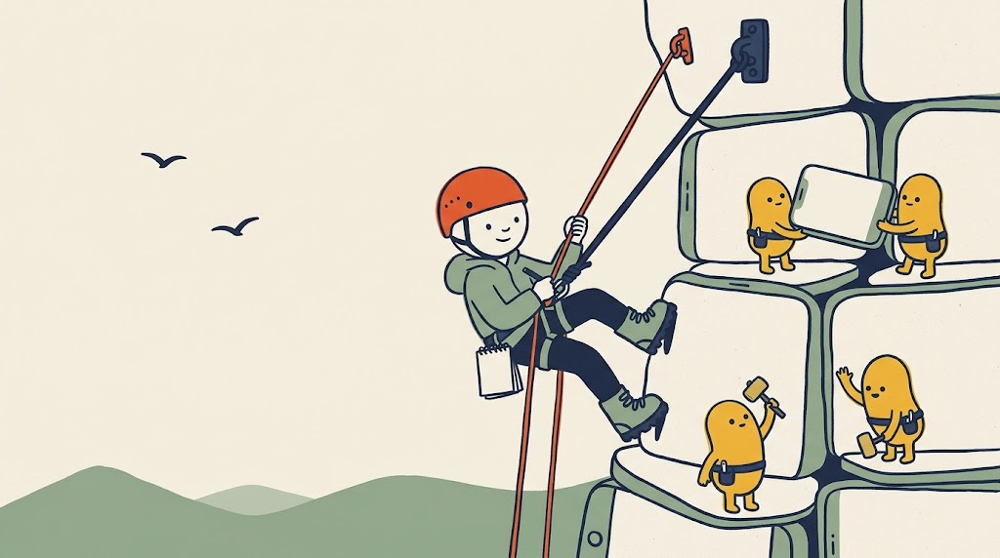<br><sub><b>Editorial illustration.</b> A consistent character style, several figures, each doing something different.</sub></td>
    <td width="50%">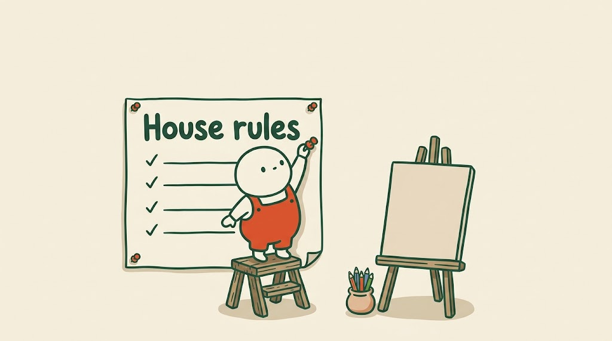<br><sub><b>Text inside an illustration.</b> The exact words, in the drawing's own style.</sub></td>
  </tr>
  <tr>
    <td width="50%">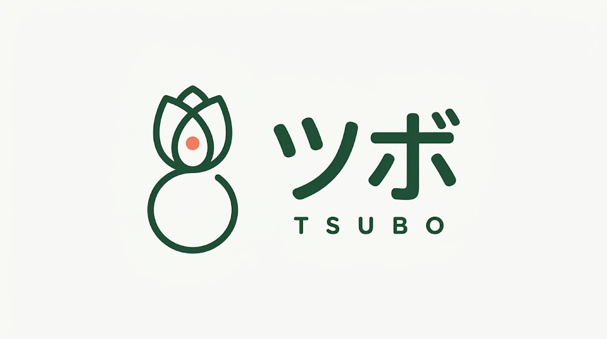<br><sub><b>Bilingual logo.</b> Exact Japanese and Latin text rendered cleanly.</sub></td>
    <td width="50%">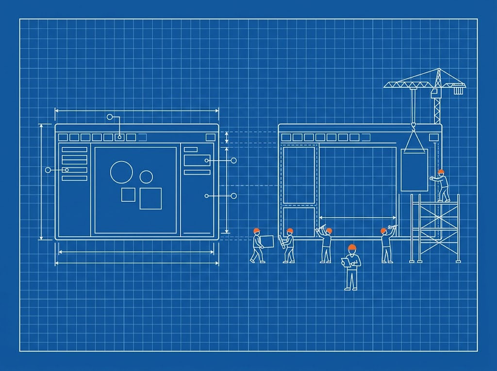<br><sub><b>Blueprint style.</b> Grid, dimension lines and a crew of figures in one consistent technical drawing.</sub></td>
  </tr>
</table>

### Photoreal concepts

<table>
  <tr>
    <td width="50%">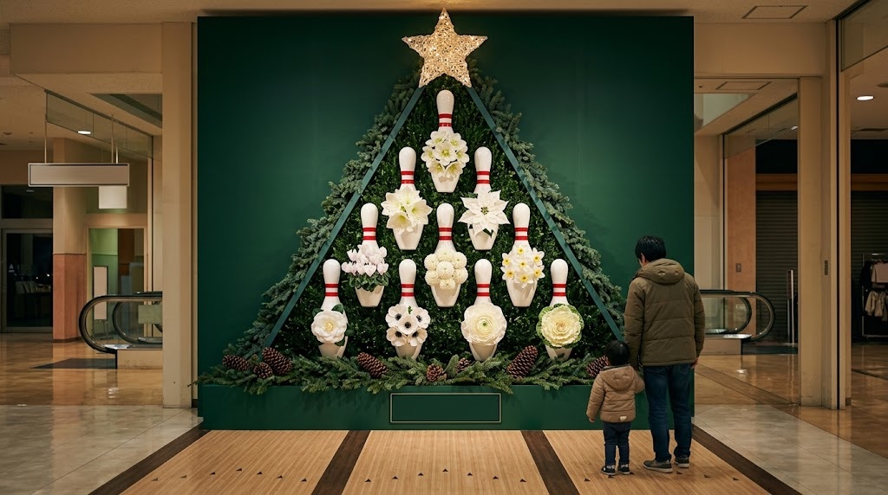<br><sub><b>Concept visual in a real setting.</b> An installation that doesn't exist yet, shown at scale with people for reference.</sub></td>
    <td width="50%">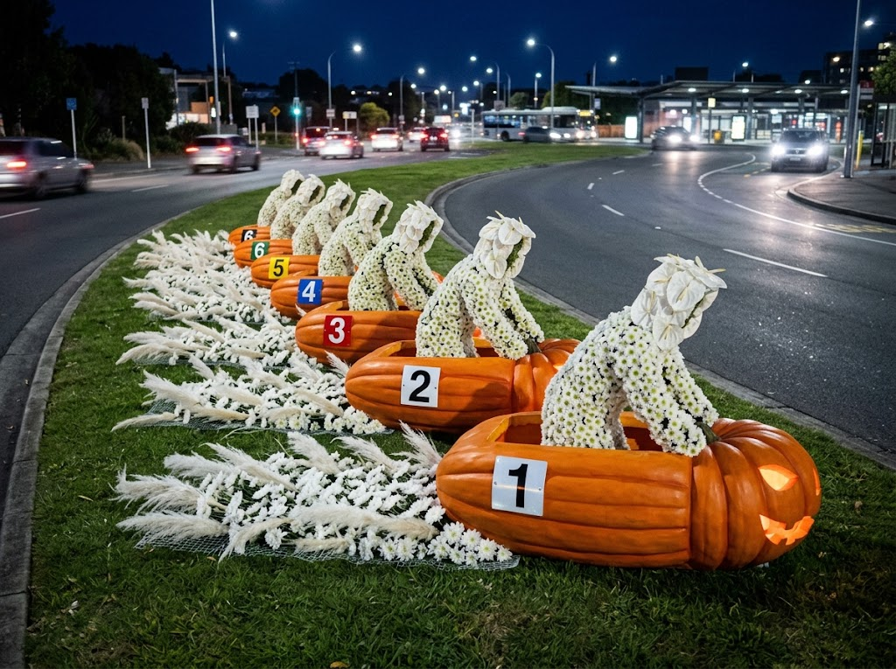<br><sub><b>An odd idea, made believable.</b> Numbered pumpkin racers on a roadside at dusk, with real-world lighting.</sub></td>
  </tr>
  <tr>
    <td width="50%">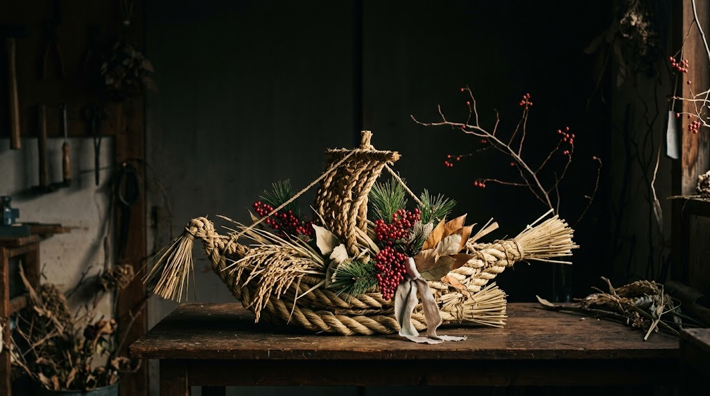<br><sub><b>Still-life photography.</b> Materials, texture and moody low-key light.</sub></td>
    <td width="50%">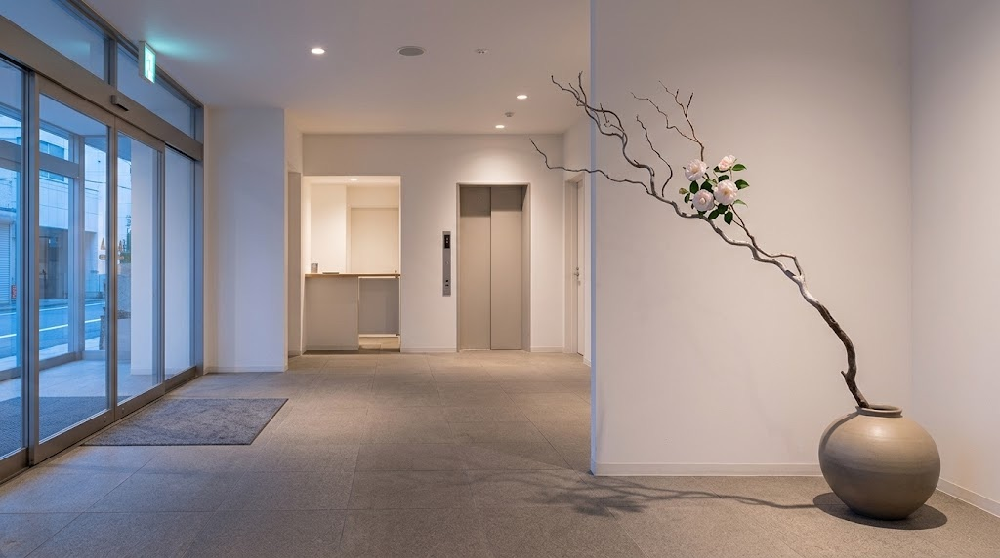<br><sub><b>Minimal interior.</b> Restraint and negative space, with one element carrying the image.</sub></td>
  </tr>
  <tr>
    <td width="50%">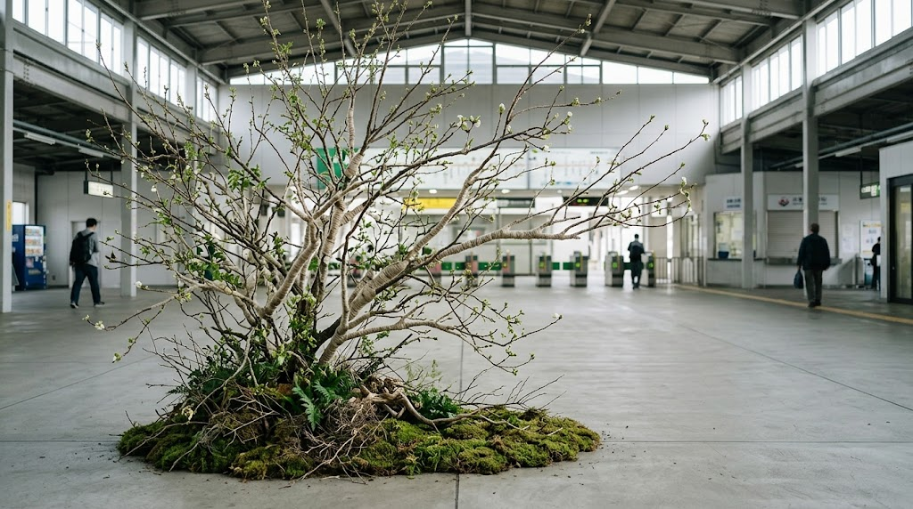<br><sub><b>Unexpected object, ordinary place.</b> A tree rooted in moss on a station concourse floor.</sub></td>
    <td width="50%">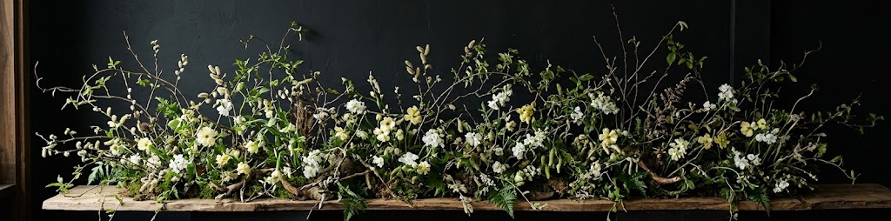<br><sub><b>Extreme 4:1 panorama.</b> A banner-shaped image, a format Nano Banana supports and GPT Image can't.</sub></td>
  </tr>
</table>

### A complex scene

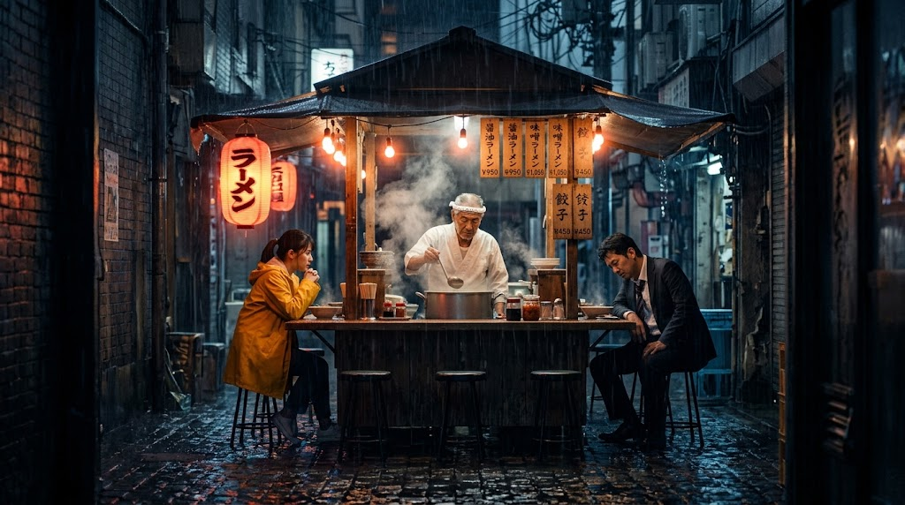

<sub><b>The ramen stall from the skill's own testing</b>: three people, two light sources, rain, steam
and Japanese text. This is the JSON-only version. It got the detail right (the tired salaryman, the
chef's headband, the ラーメン lantern), but seated the customers at opposite ends and dropped the
English from the menu. The brief-on-top format fixes exactly those two things: relationships and
must-not-fail rules go in the brief. See [Example 9](image-prompt-engineer/references/examples.md).</sub>

### A matched set: sketch, then photo, then detail

Three prompts run one after another in the same chat. Each builds on the image before it, so the
object stays the same while the medium and framing change. The sketch also carries Japanese
measurement labels.

<table>
  <tr>
    <td width="33%">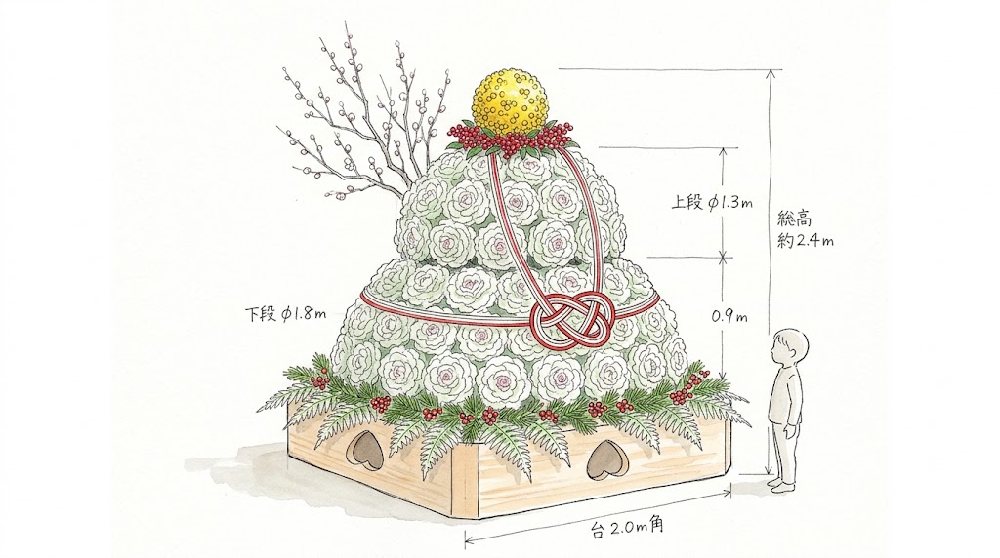<br><sub><b>1. Design sketch</b> with labelled dimensions.</sub></td>
    <td width="33%">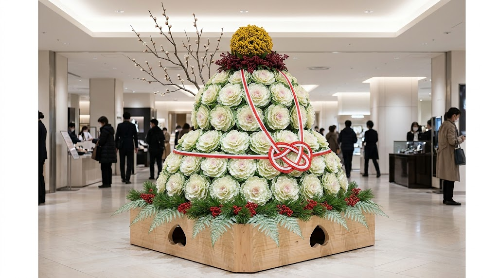<br><sub><b>2. The same object, photoreal,</b> placed in its setting.</sub></td>
    <td width="33%">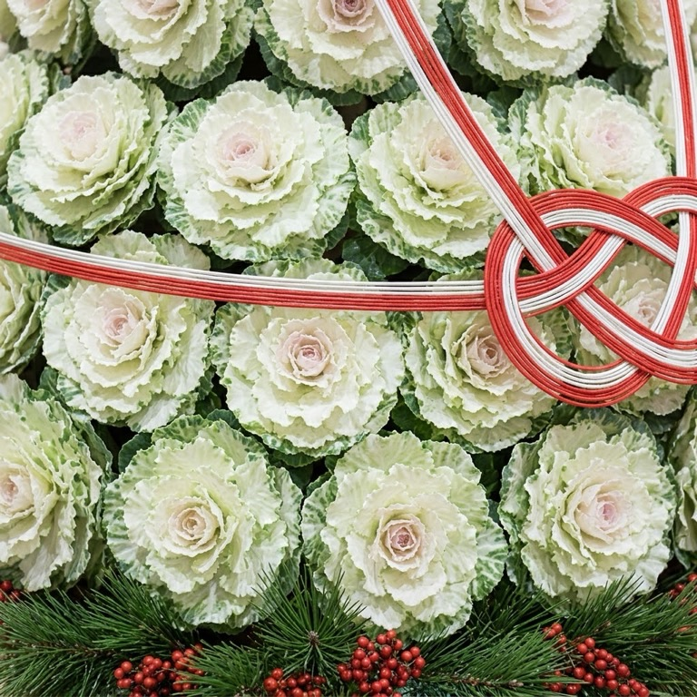<br><sub><b>3. Close-up detail</b> of the materials.</sub></td>
  </tr>
</table>

## Why JSON

A one-line prompt leaves most decisions to the model. A JSON spec makes every decision explicit:
what the subject is, how it's framed, where the light comes from, what text appears and in which
font. That has three effects:

- **Less ambiguity.** Gaps in the brief become empty fields you can see, not guesses the model makes.
- **Predictable iteration.** To change the lighting, change the `lighting` field. Everything else
  stays put.
- **Reuse.** Keep the `style` and `camera` blocks and swap the subject to make a consistent series.

The prompt you paste combines both: a plain-language summary on top, so the model understands
the image as a whole, and the JSON details underneath, so nothing is left to chance. Both models
read JSON in a prompt. For simple images, prose alone often gives near-identical results, and you
can ask for prose only. The JSON earns its place on complex images: several subjects, exact text,
precise layout.

The two halves divide the work. The summary is the brief: the scene, the mood, how the main
elements relate to each other ("sitting side by side"), and the rules that must not fail ("every
menu line in Japanese and English"). The JSON holds the detail: each person's appearance, exact
text, materials, camera and light. In testing, prose alone got relationships and overall rules
right but lost detail, while JSON alone kept detail but misread positions. Together they cover
each other.

## What it covers

It handles five kinds of image, and combines them when a brief needs more than one:
**text-to-image** from scratch, **multimodal** work with your reference images, **web-search**
images that reflect live data, **text rendering** for typography and other languages, and
**creative director** control over camera, lens, lighting and film stock.

| | Nano Banana | GPT Image |
|---|---|---|
| Models | 2.1 (default), Pro, 2, 2 Lite | 2.5 Sunburst (default), 2.5 Flare, 2 |
| Text-to-image | Yes | Yes |
| Reference images | Up to 14, by role | Numbered inputs |
| Live web search | Yes (search grounding) | No, facts are written into the prompt |
| Text rendering and localization | Yes | Yes |
| Creative director (camera, lens, film stock) | Yes | Yes |
| Edits that preserve the rest of the image | Yes | Yes, plus masks |
| Transparent backgrounds | No | Yes |

Model IDs, sizes and limits live in [`references/`](image-prompt-engineer/references), each with
the date it was last checked against the official docs.

## Example

> **You:** Hero image for a blog post about slow mornings. Warm, quiet, a bit cinematic. For Nano Banana.

The skill asks one or two questions if it needs to (or skips them if you say "just go"), then
returns one prompt to paste:

```
A cinematic lifestyle photo of a ceramic mug of black coffee on a worn oak windowsill, a thin ribbon of steam rising, in a small apartment kitchen with soft city rooftops blurred outside the window. The mug sits in the lower-left third, with wide, empty window light above for a headline. Low early-morning sun from the right casts long, soft shadows, warm amber highlights against muted shadows. Wide 16:9 landscape format.

{
  "operation": "generate",
  "framework": ["text-to-image", "creative-director"],
  "subject": "A ceramic mug of black coffee on a worn oak windowsill",
  "action": "A thin ribbon of steam rising",
  "location_context": "A small apartment kitchen, soft city rooftops blurred outside the window",
  "composition": "Close-up, mug in the lower-left third, wide empty window light above for a headline",
  "camera": { "lens": "50mm", "aperture": "f/2", "focus": "shallow depth of field on the mug rim" },
  "lighting": "Low early-morning sun from camera-right, long soft shadows",
  "style": { "genre": "cinematic lifestyle photography", "color_grading": "warm amber highlights, muted shadows" }
}
```

Under it: "Paste into the Gemini app." Then a note on settings, for anyone using a tool that has them.
Then a short list of refinements.

More worked examples: [`references/examples.md`](image-prompt-engineer/references/examples.md).

## Install

**Claude Code**

```bash
git clone https://github.com/stevensmith-design/image-prompt-engineer.git
cp -r image-prompt-engineer/image-prompt-engineer ~/.claude/skills/
```

**Claude.ai and Claude Desktop**

Download `image-prompt-engineer.skill` from the
[latest release](https://github.com/stevensmith-design/image-prompt-engineer/releases/latest), then upload it under **Settings → Capabilities → Skills**.
(To build it yourself, run `./build.sh`.)

## How to use it

No API key, no setup. You need the skill installed and an account with the image app you
already use.

1. **Ask for an image in plain words.** Name the model or app if you know it: "Write me a Nano
   Banana prompt for a hero image of a quiet Kyoto tea house at dawn", or "I need a ChatGPT image
   prompt for a logo sticker". The skill triggers on its own.
2. **Answer a few questions,** or say "just go ahead" to skip them. The skill fills the gaps with
   sensible defaults and tells you what it assumed.
3. **Follow the short instructions and copy the prompt.** Each prompt comes with four lines telling
   you what to do: where to paste it (and whether in a new chat or the same one), the target size,
   what to attach, then the prompt itself in one block. The block has a plain-language brief on top
   and the JSON details underneath. Copy the whole block, both parts together.

   ```
   Prompt 2 of 3: close-up
   - Where: the Gemini app, in the same chat, after the hero photo you just made.
   - Target: 16:9, at least 1024×576 px.
   - Attach: nothing.
   - Paste:
   ```

   In Claude.ai and Claude Desktop, use the copy button on the prompt block. In Claude
   Code (terminal or IDE), say **copy** and the skill puts the prompt on your clipboard. It never
   copies without asking, so it won't overwrite something you've already copied.
4. **Paste it into your image app:**
   - **Nano Banana**: the [Gemini app](https://gemini.google.com).
   - **GPT Image**: [ChatGPT](https://chatgpt.com).

   Neither app has an aspect ratio setting, so the skill writes it into the prompt. Free accounts
   have daily image limits. Google AI Studio and the OpenAI Playground let you pick the exact model
   and resolution, but generating images there needs a paid API key.
5. **Refine.** Tell the skill what to change ("warmer light", "move the mug left", "make the text
   Japanese") and it updates the JSON and gives you a new prompt. To edit an image you've already
   generated, attach it and say what to change and what must stay the same.

Prefer one or the other? Ask for "prose only" or "JSON only".

The skill answers in the chat. It doesn't write prompts to files unless you ask it to save them.

## Generating images from Claude Code (optional)

Skip this section if you just want prompts to paste. The skill never asks you to set up an API.

The skill includes [`scripts/generate.py`](image-prompt-engineer/scripts/generate.py), a small
script that sends a JSON spec straight to the Gemini or OpenAI API. It needs only Python 3, no
packages.

```bash
export GEMINI_API_KEY=...   # or OPENAI_API_KEY=...
GEN=~/.claude/skills/image-prompt-engineer/scripts/generate.py

python3 $GEN --spec prompts/hero.json --out images/
python3 $GEN --spec prompts/hero.json --send prose     # brief only (or --send json)
python3 $GEN --spec prompts/edit.json --ref images/hero.jpg
python3 $GEN --spec prompts/hero.json --dry-run        # print the request, send nothing
```

Settings are read from the spec's `output` block. Each image is saved with a `.json` record of the
exact prompt and settings that made it.

With a key set, Claude can run the full loop: write the spec, generate, look at the result, compare
it field by field against the spec, and fix only what's wrong. Each image costs money on your API
account, so the skill asks before generating several images or using the most expensive settings.

## Evals

[`evals/evals.json`](evals/evals.json) holds test prompts with checks for the behaviours that
matter: skipping the interview when told to, picking the right model, valid sizes, quoting text,
numbering references, handling unsupported requests, and never pushing API setup on someone who just wants a prompt. Run them with Anthropic's
[skill-creator](https://github.com/anthropics/skills) eval tooling.

## Keeping it current

Image models change every few months. When a new model ships, update its file in `references/`
(model IDs, limits, defaults and the "last checked" date) and the defaults in
`scripts/generate.py`. Pull requests are welcome.

## Credits

The five frameworks and base formulas build on Google Cloud's
[Ultimate prompting guide for Nano Banana](https://cloud.google.com/blog/products/ai-machine-learning/ultimate-prompting-guide-for-nano-banana)
and OpenAI's [image prompting guide](https://developers.openai.com/api/docs/guides/image-prompting).

Not affiliated with Google, OpenAI or Anthropic. Nano Banana, Gemini, GPT Image and ChatGPT are
trademarks of their owners.

## License

[MIT](LICENSE) © 2026 Steven Smith
